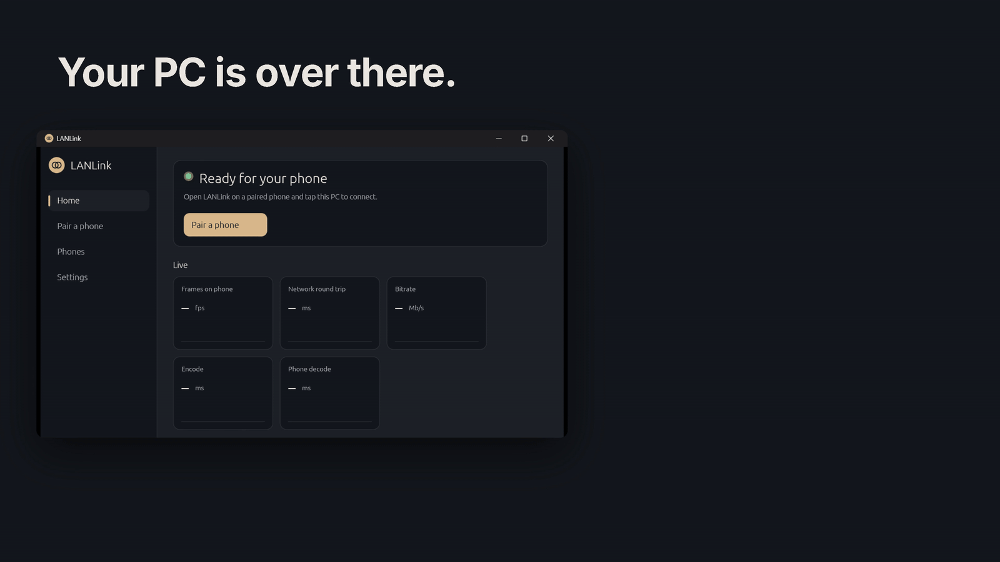
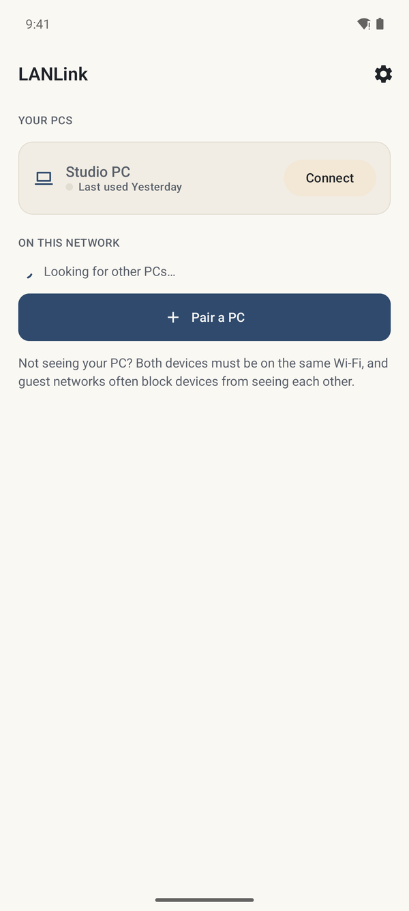
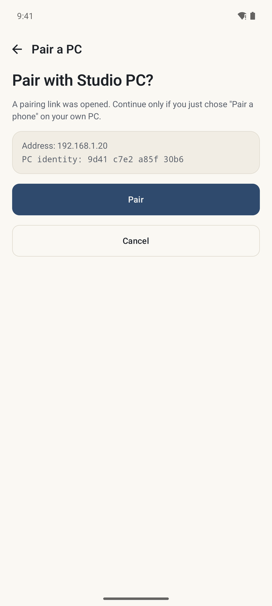
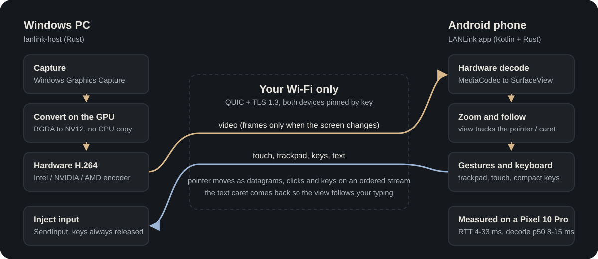
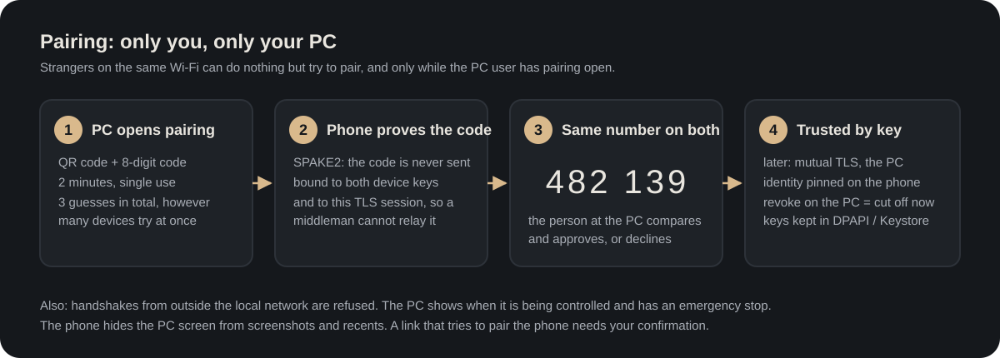

<div align="center">


# LANLink

**Your Windows PC, on your Android phone. Over your own Wi-Fi.**

No cloud relay, no account, no subscription: the screen goes straight from your PC to a phone the PC approved, encrypted end to end.


<a href="docs/media/launch.mp4"></a>

<sub>25-second launch film (click for the full-quality MP4). Names and addresses in it are fictional.</sub>

</div>

---

## How it helps


- **Away from the desk.** The PC is in the next room or across the office. Answer the chat, start the build or close the app that is spinning the fan, from the phone in your pocket.
- **Presenting.** Walk the room while the slides run on the PC. Trackpad mode gives you a real pointer: click, drag, two-finger scroll, pinch to zoom in on a detail.
- **Typing that works.** LANLink's own compact keyboard has Esc, Tab, Ctrl, Alt, Win and arrows built in. It takes about a third of the screen, and the view follows the text cursor you are typing at.
- **Private by design.** Nothing passes through anyone's server. There is no account to leak, the PC must approve each phone, and the phone hides the PC screen from screenshots and the recent-apps view.

## What it looks like

| Phone: your PCs | Phone: a pairing link asks first | Phone: settings |
|:---:|:---:|:---:|
|  |  |  |

<p align="center"><br/><sub>The PC app: pair a phone, see who is connected and live stats, stop a session at any time.</sub></p>

<p align="center"><br/><sub>The compact keyboard, as captured on a Pixel 10 Pro.</sub></p>

<sub>The phone screenshots come from the Android emulator with fictional data ("Studio PC", 192.168.1.20).</sub>

## Features

- **Pairing.** Scan a QR code, or type an 8-digit code. Both screens show the same confirmation number, and the person at the PC approves. A phone can be revoked on the PC at any time.
- **Streaming.** Windows Graphics Capture (Desktop Duplication as fallback), then colour conversion on the GPU, then hardware H.264 (Intel Quick Sync, NVIDIA or AMD through Media Foundation). The stream goes over QUIC to MediaCodec on the phone. Frames are sent only when the screen changes.
- **Input.** Trackpad and direct-touch modes; click, right-click, drag, two-axis scroll and pinch zoom; Unicode text; Ctrl, Alt, Shift and Win shortcuts; physical keyboards and mice.
- **Comfort.**
  - Landscape while controlling, with a zoomed view that follows the pointer or the text cursor.
  - A control rail at the screen edge that hides itself.
  - Three-finger tap for the keyboard.
- **Robustness.**
  - Automatic reconnection and adaptive bitrate.
  - Multiple displays.
  - Held keys are always released, even when Wi-Fi drops mid-press.
  - An emergency stop on the PC.

## How it works



- **PC side (Rust):** capture, encode and input injection.
- **Shared Rust crates:** the protocol, pairing and transport. The phone uses the same crates through a small JNI bridge.
- **Phone UI:** Kotlin and Jetpack Compose.

Details: [architecture](docs/architecture.md), [wire protocol](docs/protocol.md), and the [decision records](docs/adr).

## Security



- **Device keys.** Each device has its own key pair, and TLS 1.3 proves possession on every connection. The PC's identity is pinned on the phone.
- **Pairing.** The phone proves it knows the code with SPAKE2, so the code never crosses the network. The exchange is bound to both device keys and to the TLS session, so a machine-in-the-middle cannot relay it.
- **Guessing.** A pairing window allows 3 code guesses in total, however many devices try at once.
- **Before pairing.** An unknown device can do nothing except try to pair, and only while the PC user has pairing open. Handshakes from outside the local network are refused.
- **Pairing links.** A link from a web page or another app cannot pair the phone by itself: the phone asks first.
- **Reviewed.** The code has had a structured security review with a second, independent reviewer. The findings and their fixes are in [implementation status → Security review](docs/implementation-status.md#security-review-2026-11-17). Threat model: [docs/security-threat-model.md](docs/security-threat-model.md).

## Quick start

**Requirements**

- Windows 11 x64, ideally with a GPU that has a hardware H.264 encoder (a software fallback exists but is slow).
- An Android phone on Android 10 (API 29) or newer, ARM64.
- Both on the same network, with UDP 47990 allowed through Windows Firewall on private networks. Windows asks once.

**Build**

```powershell
scripts\build-host.ps1                    # the PC app (lanlink-host.exe)
scripts\build-android.ps1                 # the phone app, APK in android\app\build\outputs\apk
scripts\test-all.ps1                      # every automated check
```

Toolchain: Rust (pinned in `rust-toolchain.toml`), Android SDK + NDK 28.2, JDK 17+ and `cargo-ndk`. See [docs/development.md](docs/development.md).

**Pair and connect**

1. Run `lanlink-host.exe` on the PC and choose **Pair a phone**.
2. Open LANLink on the phone and scan the QR code.
3. Check that both screens show the same number, then approve on the PC.
4. From then on, open the app and tap **Connect**.

## Status

This is a **development build**. No release has been made yet: there is no installer, and the binaries are not signed. What is verified:

- **Tests:** 126 Rust tests (unit, property, loopback end to end) and 34 Android unit tests pass on the development PC; lint reports no errors.
- **Real phone:** a Pixel 10 Pro (Android 17) streamed the PC over Wi-Fi.
  - Measured network round trip 4–33 ms.
  - Phone decode p50 8–15 ms.
  - Encode p50 about 26 ms (NVIDIA).
- **Not yet measured:** glass-to-glass latency.
- **Not supported yet:** audio, clipboard sharing, and codecs other than H.264.

The full, evidence-backed list (what is done, what is only partly verified, what is not started) is in [docs/implementation-status.md](docs/implementation-status.md).

## Repository layout

```
crates/   lanlink-protocol, lanlink-auth, lanlink-transport,
          lanlink-discovery, lanlink-client      (shared, cross-platform)
host/     capture-windows, encoder, input-windows, session-manager,
          app (window + tray), dev-host (console host)      (Windows)
android/  app (Kotlin/Compose), native-bridge (Rust JNI)
tests/    integration: host + client end to end over loopback QUIC
docs/     architecture, protocol, threat model, performance, ADRs, status, media
scripts/  build, test, benchmark, firewall helper
brag-output/  the launch film's plan, share copy and HyperFrames source
```

## Contributing

Issues and pull requests are welcome. See [CONTRIBUTING.md](CONTRIBUTING.md). Report security problems privately as described in [SECURITY.md](SECURITY.md), not in a public issue.

## License

Dual-licensed under [MIT](LICENSE-MIT) or [Apache-2.0](LICENSE-APACHE), at your option. Third-party licences are discussed in [ADR 0010](docs/adr/0010-licensing.md).

<sub>The launch film was made with the [brag](https://github.com/latent-spaces/brag) approach (plan → storyboard → render) using [HyperFrames](https://hyperframes.heygen.com). Its plan is in [brag-output/brag-plan.md](brag-output/brag-plan.md).</sub>
