<div align="center">


# LANLink

**Your Windows PC, on your Android phone. Over your own Wi-Fi.**

No cloud relay, no account, no subscription: the screen goes straight from your PC to a phone the PC approved, encrypted end to end.

[](https://github.com/Abhitodan/lanlink/actions/workflows/ci.yml)
[](https://github.com/Abhitodan/lanlink/releases/latest)


<p>
  <a href="#how-it-helps">How it helps</a> ·
  <a href="#what-it-looks-like">Screenshots</a> ·
  <a href="#iphone-app-work-in-progress">iPhone</a> ·
  <a href="#features">Features</a> ·
  <a href="#how-it-works">Architecture</a> ·
  <a href="#security">Security</a> ·
  <a href="#quick-start">Quick start</a> ·
  <a href="https://github.com/Abhitodan/lanlink/releases/latest">Releases</a>
</p>

<a href="docs/media/launch.mp4"></a>

<sub>25-second launch overview (click for full-resolution MP4). Names and addresses shown are fictional.</sub>

</div>

---

## How it helps

<p align="center">
  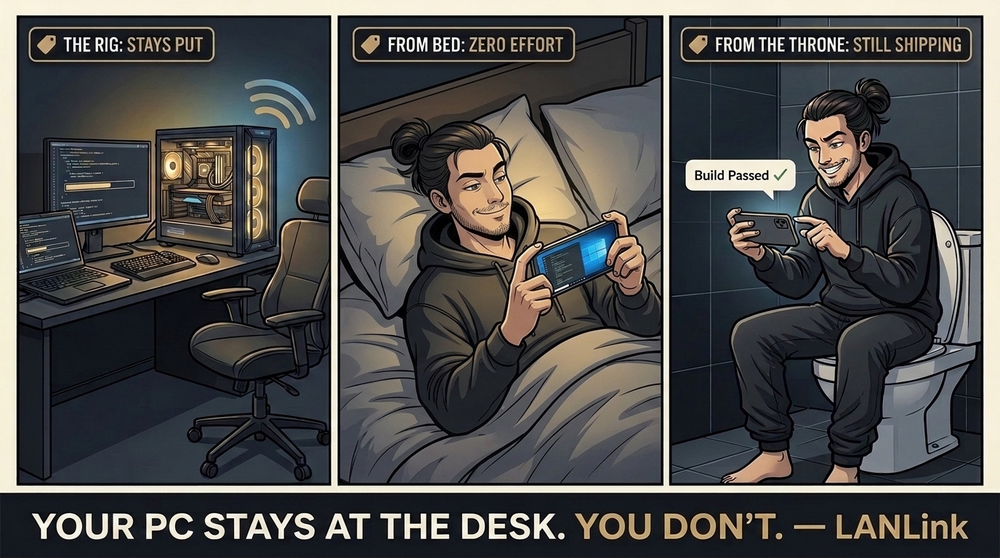
</p>

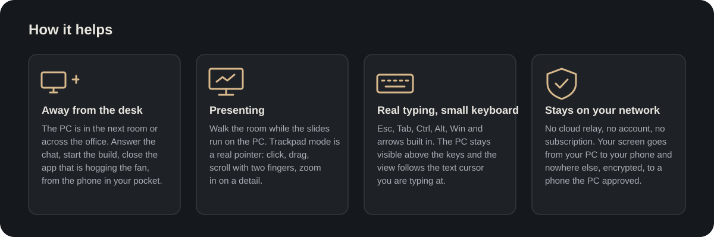

- **Away from the desk.** The PC is in the next room or across the office. Answer the chat, start the build, or close the app that is spinning the fan—right from the phone in your pocket.
- **Presenting.** Walk the room while the slides run on the PC. Trackpad mode gives you a real pointer: click, drag, two-finger scroll, pinch to zoom in on a detail.
- **Typing that works.** LANLink's compact keyboard has `Esc`, `Tab`, `Ctrl`, `Alt`, `Win`, and arrow keys built in. It takes about a third of the screen, and the view automatically follows the text cursor you are typing at.
- **Private by design.** Nothing passes through anyone's server. There is no account to leak, the PC must approve each phone, and the phone hides the PC screen from screenshots, screen recordings, and the recent-apps view.

## What it looks like

| Phone: your PCs | Phone: a pairing link asks first | Phone: settings |
|:---:|:---:|:---:|
|  |  | 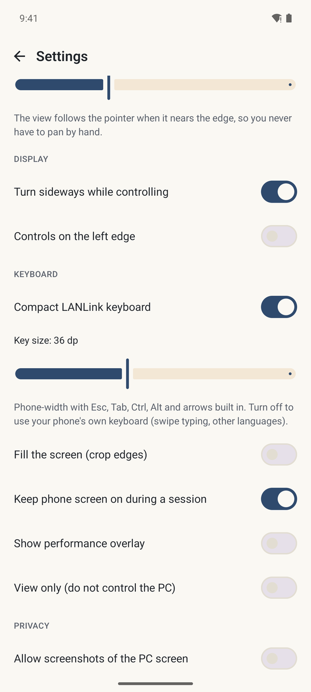 |

<p align="center">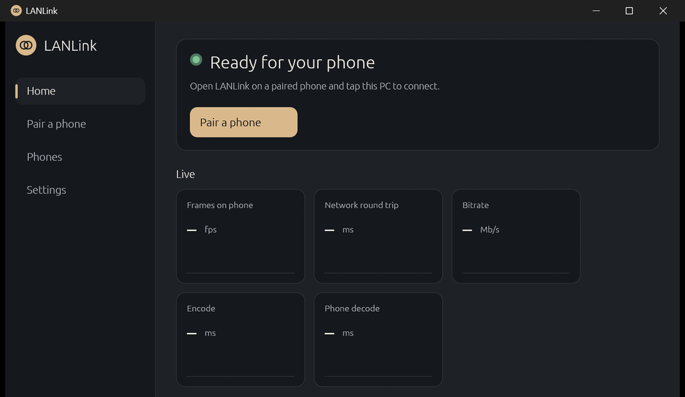<br/><sub>The Windows PC app: pair a phone, see who is connected and live pipeline telemetry, or stop a session at any time.</sub></p>

<p align="center">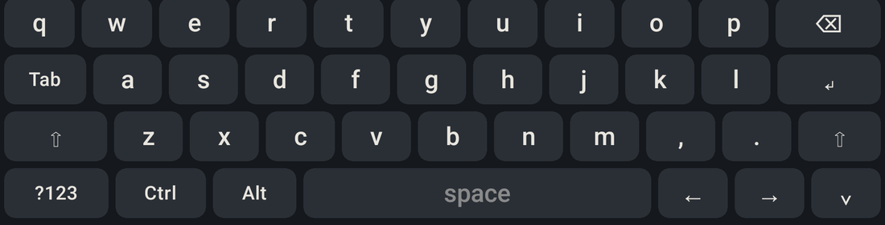<br/><sub>The compact PC keyboard on Android, captured on a Pixel 10 Pro.</sub></p>

<sub>Phone UI screenshots use fictional host data ("Studio PC", `192.168.1.20`).</sub>

## iPhone app (work in progress)

An iPhone client is under development on the `ios-app` branch. It is a Swift/SwiftUI twin of the Android app and uses the same Rust core through a C interface (`ios/native-bridge`, the `lanlink-ios` crate). It needs iOS 16 or newer.

**Status:** the app builds and its automated tests pass on GitHub's macOS runners, but it has **not been run on a real iPhone, and not against a real PC from an iPhone**. There are no latency numbers for it. The screenshots below come from the simulator UI tests and show fictional data. The full list of what is and is not verified is in [docs/implementation-status.md](docs/implementation-status.md#iphone-app-ios-app-branch).

| Home: your PCs | Pairing link asks first | Pair a PC | First launch | Security |
|:---:|:---:|:---:|:---:|:---:|
| 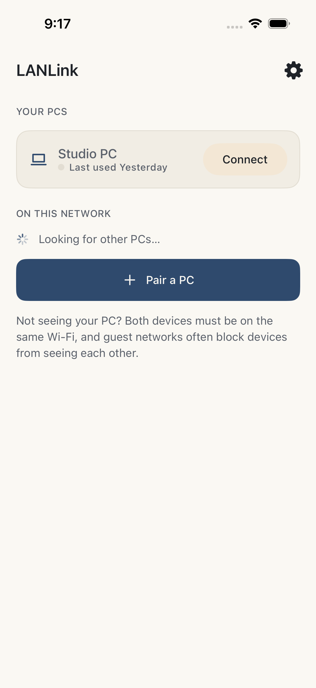 | 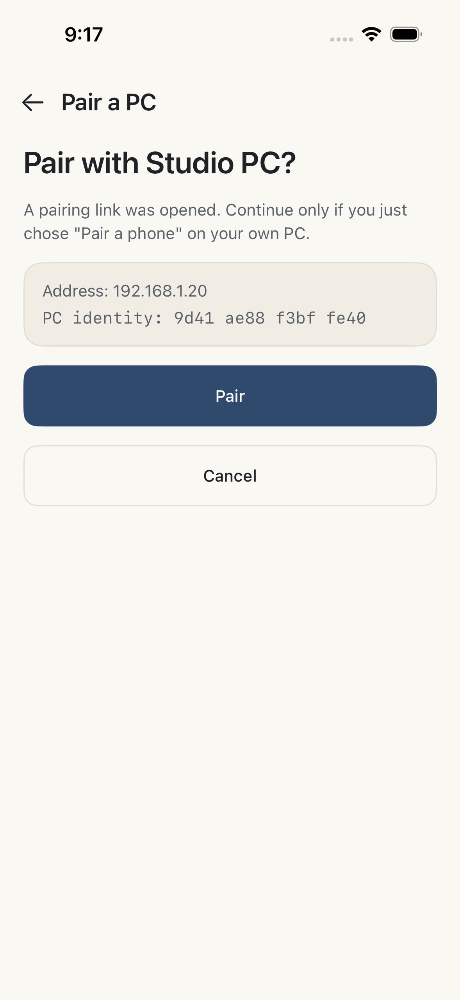 | 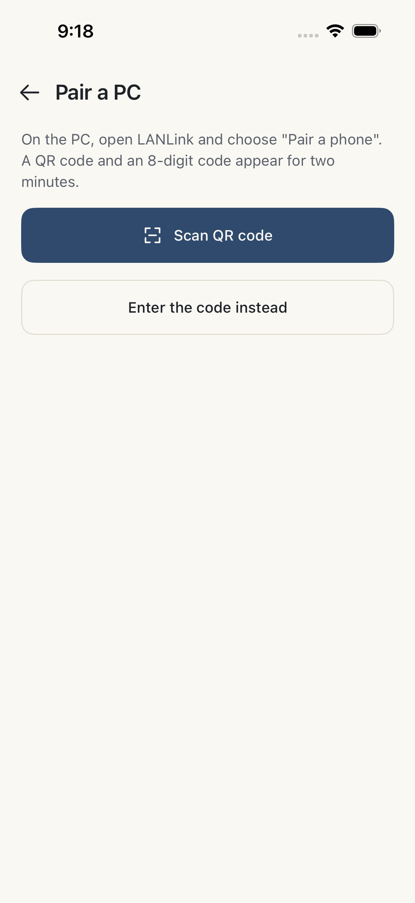 | 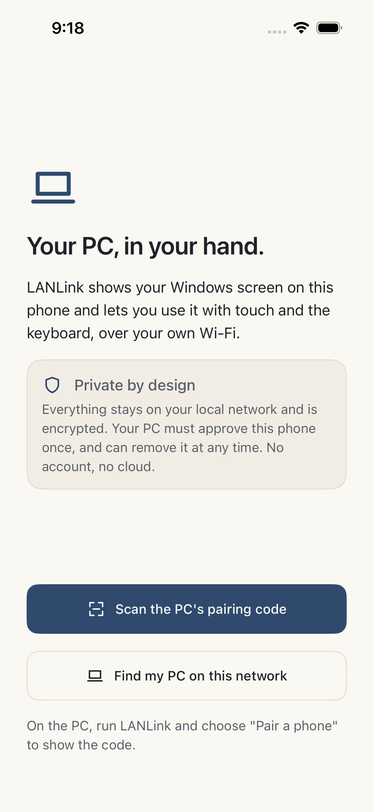 | 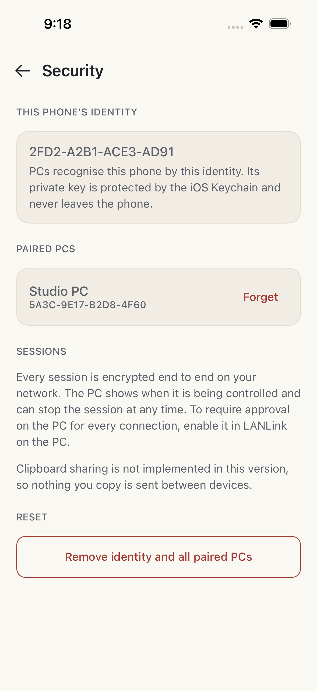 |

| Settings | Touch and pointer settings | Performance | Remote view, compact keyboard | Display and keyboard settings |
|:---:|:---:|:---:|:---:|:---:|
|  | 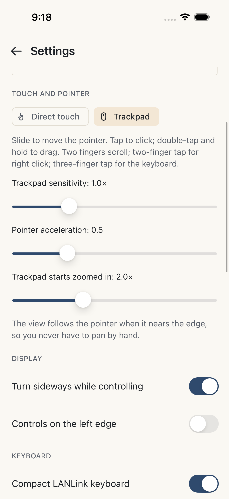 | 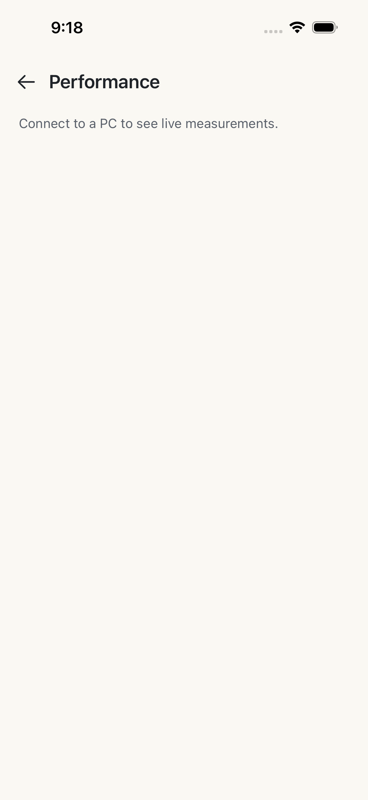 | 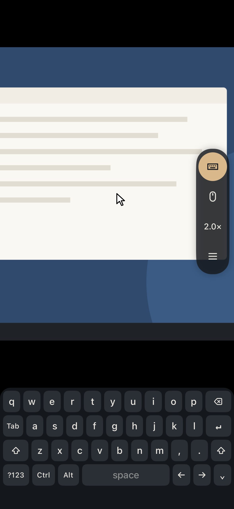 | 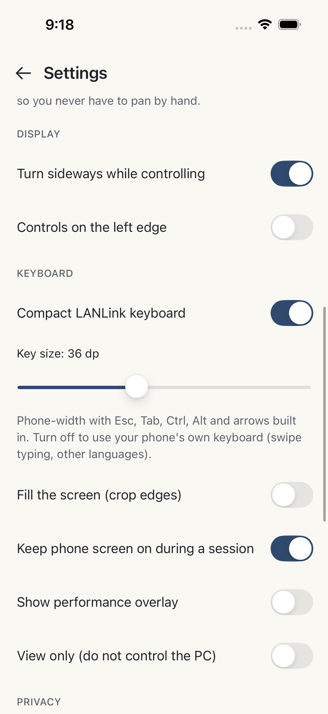 |

<sub>Simulator screenshots from the UI tests (`ios-screenshots` artifact of the `ios` workflow). Fictional host data ("Studio PC", `192.168.1.20`).</sub>

Build instructions: [docs/development.md](docs/development.md#iphone-app). Nothing is signed by the repository; running on a device needs your own Apple signing team.

## Features

- **Zero-trust LAN pairing.** Scan a QR code or enter an 8-digit code. Both screens display the same 6-digit confirmation number derived from SPAKE2 + the TLS 1.3 session exporter, and the person at the PC approves. Any paired phone can be revoked on the PC at any time.
- **Zero-copy GPU streaming.** Windows Graphics Capture (`DXGI Desktop Duplication` fallback) → GPU `D3D11` video processor (`BGRA` to `NV12`) → hardware H.264 Media Foundation MFT (Intel Quick Sync, NVIDIA NVENC, AMD AMF). Streamed over QUIC to Android `MediaCodec` (`SurfaceView`) with low-latency frame gating. Frames are sent only when the desktop changes.
- **Precision input.**
  - **Trackpad & direct-touch modes:** idempotent phone-integrated pointer positioning (unaffected by Windows mouse acceleration or lost UDP datagrams), velocity-sensitive precision curve, click, right-click, drag, two-axis natural scroll, and pinch zoom.
  - **Keyboard & IME:** layout-independent Unicode text, `Ctrl`/`Alt`/`Shift`/`Win` sticky modifiers and combos, IME composition support, and hardware Bluetooth/USB keyboard + mouse passthrough.
- **Phone ergonomics.**
  - Landscape control view starting at 2× zoom with a dead-zone follow camera (`60%` central zone) that tracks the pointer or the active Windows text caret (`Win32` + `UI Automation`).
  - Auto-hiding edge control rail (right or left edge), zoom presets (`Fit`, `2×`, `1:1` actual pixels), and three-finger tap to toggle the keyboard.
- **Desktop safety & resilience.**
  - On-screen border indicator and stop bar on Windows (`WDA_EXCLUDEFROMCAPTURE` so it never appears in the stream) plus global emergency-stop hotkey (`Ctrl+Alt+Shift+Esc`).
  - Automatic session lock / UAC secure-desktop detection (drops non-release input while locked).
  - Automatic reconnection (up to 60 s) and adaptive bitrate control.
  - Guaranteed release of all held keys and mouse buttons on disconnect, session end, or app backgrounding.

## How it works


- **Windows Host (`host/`):** Rust workspace crates for display enumeration and capture (`capture-windows`), GPU NV12 conversion and Media Foundation H.264 encoding (`encoder`), `SendInput` injection and UI Automation caret tracking (`input-windows`), session orchestration and DPAPI storage (`session-manager`), native GUI + system tray (`app`), and terminal host (`dev-host`).
- **Shared Core (`crates/`):** Cross-platform wire protocol (`lanlink-protocol`), identity and SPAKE2 pairing (`lanlink-auth`), mutual-TLS QUIC transport (`lanlink-transport`), DNS-SD discovery (`lanlink-discovery`), client state machine (`lanlink-client`), and platform-neutral mobile bridge (`lanlink-mobile`).
- **iPhone Client (`ios/`, in progress):** SwiftUI app, `AVSampleBufferDisplayLayer` video path (`CMSampleBuffer` from H.264 Annex-B), Keychain identity storage, and a C-ABI Rust layer (`ios/native-bridge`, crate `lanlink-ios`) over `lanlink-mobile`.
- **Android Client (`android/`):** Kotlin + Jetpack Compose UI, custom low-latency `SurfaceView` + `CursorView` + `MediaCodec` pipeline, Android Keystore `AES-256-GCM` identity protection, and a thin panic-safe Rust JNI layer (`android/native-bridge`).

Deep-dive documentation:
- [Architecture & Threading Model](docs/architecture.md)
- [Binary Wire Protocol Specification (v1 & v2)](docs/protocol.md)
- [Security Threat Model](docs/security-threat-model.md)
- [Performance & Latency Benchmarks](docs/performance.md)
- [Architecture Decision Records (ADRs 0001–0011)](docs/adr/README.md)

## Security


- **Mutual TLS 1.3 with pinned identities.** Every device generates an `ECDSA P-256` certificate and private key (`DPAPI`-encrypted on Windows; `Android Keystore` `AES-256-GCM` on Android, excluded from cloud backup and device transfer). 0-RTT is disabled.
- **Channel-bound SPAKE2 pairing.** The phone proves knowledge of the 8-digit pairing code using SPAKE2 (`Ed25519` group) bound to both certificate SHA-256 fingerprints and the RFC 8446 TLS 1.3 exporter (`EXPORTER-lanlink-pair-v1`). The pairing code never crosses the network, and a machine-in-the-middle cannot relay the exchange.
- **Strict rate & slot limits.** A pairing window lasts 120 seconds and permits at most 3 attempts globally across all concurrent connections (reserved atomically at exchange start). Unpaired peers are capped to 4 of 8 connection slots and cannot send any message other than `PairRequest` / `PairConfirm`.
- **Deep-link & UI safety.** External `lanlink://pair` links never auto-connect—they display an explicit confirmation card and strip non-LAN addresses. Network-supplied device names are sanitized against Unicode bidirectional overrides and control characters.
- **Screen & input privacy.** Android enables `FLAG_SECURE` during remote sessions by default (blocking screenshots, screen recording, and Recents thumbnails) and requests `IME_FLAG_NO_PERSONALIZED_LEARNING` when the system IME is used.

See [docs/security-threat-model.md](docs/security-threat-model.md) and the security audit ledger in [docs/implementation-status.md](docs/implementation-status.md#security-review-2026-11-17).

## Quick start

### Requirements

- **PC:** Windows 11 x64 with a hardware H.264 GPU encoder (Intel Quick Sync, NVIDIA NVENC, or AMD AMF via Media Foundation; software fallback is supported).
- **Phone:** Android 10 (API 29) or newer (`arm64-v8a`, `armeabi-v7a`, or `x86_64`).
- **Network:** Same local Wi-Fi / LAN, with inbound `UDP 47990` (and `UDP 5353` for mDNS discovery) allowed on private networks.

### Option 1: Download prebuilt release

1. Download `lanlink-v0.1.0-windows-x64.zip` and `lanlink-v0.1.0-android.apk` from [Releases](https://github.com/Abhitodan/lanlink/releases/latest) (verify against `SHA256SUMS.txt`).
2. Extract the Windows archive and run `lanlink-host.exe` (or run `firewall-allow.ps1` once in an elevated PowerShell prompt to allow UDP 47990 on private networks).
3. Install `lanlink-v0.1.0-android.apk` on your Android phone.

### Option 2: Build from source

```powershell
scripts\build-host.ps1                    # Windows GUI (lanlink-host.exe) + CLI (lanlink-host-console.exe)
scripts\build-android.ps1 -Release        # Android native libraries (arm64-v8a, x86_64) + release APK
scripts\package-release.ps1               # Full production bundle + SHA256SUMS.txt in dist\
scripts\test-all.ps1                      # Format, clippy (-D warnings), Rust test suite, Android unit tests + lint
```

Toolchain: Rust `1.85+` (pinned in `rust-toolchain.toml`), Visual Studio Build Tools 2022 (Windows SDK `10.0.26100`), Android SDK Platform 35 + NDK `28.2.13676358`, JDK 17+, and `cargo-ndk`. Full setup instructions: [docs/development.md](docs/development.md).

### Pair and connect

1. Launch `lanlink-host.exe` on your PC and click **Pair a phone**.
2. Open **LANLink** on your phone and scan the QR code (or enter the 8-digit code).
3. Verify that both screens display the same 6-digit confirmation number, then click **Approve** on the PC.
4. Tap **Connect** on your phone whenever both devices are on the same Wi-Fi.

## Verification & Benchmarks

| Suite / Metric | Result |
|---|---|
| **Rust automated tests** | **138 passed** (unit, `proptest` fuzzing at 2,000 cases/property, `lanlink-mobile` fake-host integration, and loopback QUIC end-to-end) |
| **Android automated checks** | **35 unit tests passed** (`CoreLogicTest`), `lintDebug` **0 errors** |
| **PC capture → GPU NV12 convert + submit** | `0.8 ms` p50 / `1.3–1.6 ms` p95 (`2560×1600` source → `1920×1200` NV12 on D3D11) |
| **PC compose → H.264 encoded** | `13.5–14.5 ms` p50 / `24.0–30.0 ms` p95 (Intel Quick Sync & NVIDIA MFT) |
| **Real phone over Wi-Fi (Pixel 10 Pro)** | Network RTT `4–33 ms`, hardware decode `8–15 ms` p50, `0` dropped client frames |

See [docs/implementation-status.md](docs/implementation-status.md) and [docs/performance.md](docs/performance.md) for the complete verification ledger and methodology.

## Repository layout

```text
crates/
  lanlink-protocol/    Typed binary wire protocol, bounded codecs, FrameGate, InputSequencer
  lanlink-auth/        ECDSA P-256 identity, SPAKE2 pairing, trust store, QR pairing URI
  lanlink-transport/   Quinn QUIC endpoints, pinned mutual TLS 1.3, framed stream I/O
  lanlink-discovery/   mDNS / DNS-SD (_lanlink._udp.local.) advertise & browse
  lanlink-client/      Cross-platform client state machine, reconnect & input pacing
  lanlink-mobile/      Shared mobile runtime, handle registry, JSON events & Annex-B video prep
host/
  capture-windows/     Monitor enumeration, Windows Graphics Capture, DXGI Desktop Duplication, cursor shapes
  encoder/             D3D11 GPU NV12 conversion + Media Foundation hardware H.264 MFT
  input-windows/       SendInput injection, virtual-desktop coordinate mapping, UIA caret tracking
  session-manager/     Host session lifecycle, pairing window, adaptive bitrate, DPAPI storage
  app/                 Windows GUI application (lanlink-host.exe), system tray & screen border indicator
  dev-host/            Windows console host (lanlink-host-console.exe) & test harness
android/
  app/                 Kotlin + Jetpack Compose client, SurfaceView/MediaCodec decoder, Keystore storage
  native-bridge/       Panic-safe JNI glue over lanlink-mobile (liblanlink.so)
ios/
  LANLink/             SwiftUI app (in progress); Swift unit tests in LANLinkTests, UI tests in LANLinkUITests
  native-bridge/       C-ABI glue over lanlink-mobile (liblanlink_ios.a, packaged as LanLinkCore.xcframework)
tests/
  integration/         Full host + client loopback QUIC end-to-end integration test suite
docs/                  Architecture, wire protocol, threat model, benchmarks, release guide, ADRs
scripts/               PowerShell build, test, benchmark, release packaging & firewall scripts
```

## Contributing

Bug reports and pull requests are welcome—please read [CONTRIBUTING.md](CONTRIBUTING.md) before submitting a PR. Report security vulnerabilities privately via [SECURITY.md](SECURITY.md).

## License

Dual-licensed under [MIT](LICENSE-MIT) or [Apache-2.0](LICENSE-APACHE), at your option. Third-party dependency licensing is documented in [ADR 0010](docs/adr/0010-licensing.md).
